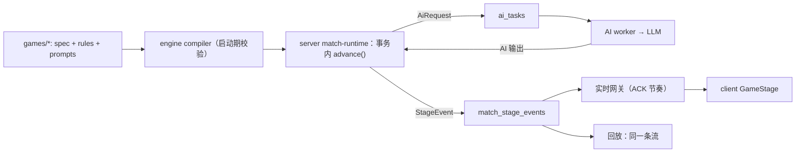

# 通用 AI 对战引擎设计（全新项目）

## 目标

从零重建一个**通用 AI 对战平台**：

- 新玩法 = 一份 TypeScript `GameSpec`（流程结构）+ `rules.ts`（类型化纯函数）+ `prompts.ts`（提示词模板）。
- 引擎负责流程推进、AI 调度、合法性校验、信息隔离、重试兜底、调试、持久化、回放与播放协议。
- 前端只有一个通用舞台 `GameStage`，按 spec 声明的布局渲染，个别游戏可挂专用组件。
- 首版只做两个游戏：**辩论赛**与**狼人杀标准 12 人局**（预女猎白 + 警长）。其他狼人杀板子之后按批次补；谁是卧底、阿瓦隆暂不做。

配置者是**团队自己**：spec 在仓库里写、走 git review，靠 TypeScript 类型与启动期校验保证正确。不做可视化编辑器，不做后台提示词编辑。

## 已确认决策（2026-10-30）

1. 当成全新项目，旧代码、旧数据、旧部署流程全部不保留。
2. 旧对局历史与回放直接丢弃；配置数据（玩家、模型、音色）在新后台重新录入，不做导入工具。
3. 数据库直接使用 PostgreSQL，全新 schema；不再有 SQLite、`db-migrator`、切换演练与冻结门禁 runbook。
4. 观众视角默认 `public`，单个游戏可声明 `omniscient`。
5. 新增 `packages/engine` 与 `packages/games`。
6. 首版只做辩论赛与狼人杀；阿瓦隆、谁是卧底延后。引擎的基础动作以这两个游戏的需求为准，不为延后的游戏提前做抽象。

## 第一性约束

1. **裁判确定，AI 只是玩家**。胜负、合法性、淘汰、计票只由规则决定；AI 只产出"发言文本"或"在合法集合内的选择"。唯一例外是显式声明的 `judge` 动作（如辩论评委），它的打分作为 AI 决策记录，汇总仍由规则执行。
2. **信息隔离由引擎强制**。每条日志都有可见频道；AI 看到的历史和模板变量由引擎按该玩家的可见范围生成，模板拿不到不可见的数据。
3. **一定会结束**。所有阶段有访问上限，整局有轮次、AI 调用和 token 预算；超限按 spec 的终局规则收尾。
4. **可复现**。同一 spec 版本 + 种子 + AI 输出序列，结果唯一。随机数只能来自引擎提供的种子 RNG。
5. **结构是数据，逻辑是函数**。阶段图（有哪些阶段、什么动作、谁参与、怎么跳转）是声明式数据，引擎据此调度、渲染调试台、做静态校验；条件、选择器、结算是类型化纯函数，不发明表达式语言——配置者就是写 TS 的团队，DSL 没有消费者。
6. **引擎无 IO**。engine 包不访问数据库、网络、时钟；LLM、持久化、时间都由 server 通过端口注入。整局可在内存中跑完，测试和调试都依赖这一点。

## 总体架构

```txt
packages/
  engine/   纯运行时：spec 类型与 defineGame、编译校验、解释器、基础动作、可见性、提示词组装、校验兜底、调试脚本、内存测试夹具
  games/    每个游戏一个目录：spec.ts、rules.ts、prompts.ts、debug.ts、*.test.ts
  server/   Express + ws + pg：配置、迁移、鉴权、资源 CRUD、对局运行时、AI worker、LLM、TTS、实时网关、trace
  client/   C 端：大厅（选游戏/选玩家）、GameStage、历史与回放
  admin/    B 端：登录、模型供应商/模型/音色/玩家、对局列表、Trace、调试台
  shared/   协议：StageEvent、观众视图、游戏目录、WebSocket 消息的类型与 zod schema
```

依赖方向：`games → engine → shared`；`server → engine + games + shared`；`client / admin → shared`。engine 不依赖 server。



## GameSpec 模型

### 组成

| 字段 | 职责 |
| --- | --- |
| `key / version / title / description` | 标识与版本；每局固化 `gameKey + specVersion + specHash` |
| `players` | 人数范围 |
| `params` | 开局参数的 zod schema（如辩题）；未提供时由 `setup.init` 用种子 RNG 生成 |
| `rulesText` | 给 AI 的游戏规则说明（模板） |
| `roles` | 角色、阵营、身份模板、席位编号（如正方一辩到四辩） |
| `setup` | 身份分配（数量或 `rest`）+ 初始化规则函数（如抽辩题） |
| `state` | 游戏自定义状态的 zod schema，并声明每个字段的可见性 |
| `phases` | 阶段字典：每个阶段是一种基础动作 + 跳转 |
| `triggers` | 事件触发的插入阶段（压栈执行后返回），用于死亡链、开枪、遗言 |
| `end` | 胜者判定函数 |
| `budget` | 最大轮次、默认阶段访问上限、AI 调用上限（token 上限待服务端接入后补）、超限终局 |
| `presentation` | 布局、座位分区、观众视角、公开视图函数、终局揭示、专用组件 |
| `variants` | 同一游戏的玩法变体：角色集与参数覆盖（如狼人杀板子） |
| `debug` | 确定性脚本、默认断点 |

引擎内置状态：`seats[]`（座位号、玩家档案、角色、阵营、存活）、`round`、`phaseStack`、`phaseVisits`、`log[]`（带频道）、`rng` 游标、`budgetUsed`。游戏只声明附加字段。

### 基础动作（phase kind）

| kind | 作用 | 关键配置 |
| --- | --- | --- |
| `announce` | 主持播报，不调用 AI | 文案（模板或函数）、频道 |
| `speak` | 一组玩家发言 | `actors`、`order`（座位 / 函数 / 种子随机 / 并行）、输出 schema、内容校验、兜底 |
| `act` | 在合法集合内选择 | `actors`、`targets`、数量、`allowNone`（可放弃，如女巫不用药）、输出 schema、`apply`（写回状态）、兜底 |
| `vote` | `act` + 计票 | 投票者、候选人、`weight`（如警长 1.5 票）、平票策略（复投 N 次后种子随机 / 无人出局 / 函数）、`onResult` |
| `judge` | AI 评委给出判定与点评 | 评委、判定选项及含义、并列时的判定、点评字数 |
| `compute` | 纯函数结算 | `(ctx) → { state, log }`，复杂规则的唯一出口 |
| `reveal` | 把信息公开到指定频道 | 揭示内容函数、目标频道 |

刻意不提供：自由脚本阶段、循环语句。循环 = 跳回已有阶段 + `maxVisits`。

### 跳转、阶段栈与触发器

- `next` 是阶段 ID，或有序的 `{ when: (ctx) => boolean, goto }` 列表，最后一项为兜底；`goto` 为阶段 ID、`'end'` 或 `'return'`（弹栈）。可附带 `round: 'increment'`。
- `triggers`：`{ on: 'seat_eliminated' | 'phase_completed' | 'action_declared' | ..., when, push | jump }`。
  - `push`：把阶段压栈，执行到 `return` 回原位置（遗言、猎人开枪、移交警徽）；触发器内可再触发，深度上限由 budget 控制。
  - `jump`：放弃当前阶段链，清空阶段栈后直接跳转（狼人白天自爆 → 立即入夜）。
- `action_declared` 来自输出 schema 中声明的可选附加动作，例如狼人发言时可附带 `selfDestruct: true`；引擎校验该座位是否有权声明，再派发事件。
- 所有阶段 ID 引用在编译期校验：引用不存在、存在不可达阶段、`return` 出现在非栈阶段，服务启动失败。

### 上下文与选择器

规则函数、条件、选择器都接收只读的 `ctx`：

```ts
ctx.state            // 游戏自定义状态（冻结对象）
ctx.seats.alive()    // 座位查询：.withRole('seer') .inTeam('wolf') .position(1) .except(seat) .ids() .count()
ctx.round / ctx.phase / ctx.result   // result 为当前阶段动作结果（如计票）
ctx.rng              // 种子随机数，按阶段与用途派生
```

`actors`、`targets` 由函数返回座位集合。合法目标在服务端算好，同时进入 prompt 与校验器，两边永远一致。

### 示例：辩论赛

```ts
// games/debate/spec.ts
export default defineGame({
  key: 'debate',
  version: 1,
  title: 'AI 辩论赛',
  players: { min: 9, max: 12 },
  params: z.object({ topic: topicSchema.optional() }),
  rulesText: prompts.rules,
  roles: {
    pro: { team: 'pro', identity: prompts.debater, positions: 4 },
    con: { team: 'con', identity: prompts.debater, positions: 4 },
    judge: { team: 'judge', identity: prompts.judge },
  },
  setup: { assign: { pro: 4, con: 4, judge: 'rest' }, init: rules.pickTopic },
  start: 'topic_reveal',
  phases: {
    topic_reveal: { kind: 'announce', text: prompts.topicAnnounce, next: 'opening' },
    opening: {
      kind: 'speak',
      actors: (ctx) => [ctx.seats.inTeam('pro').position(1), ctx.seats.inTeam('con').position(1)],
      prompt: prompts.opening,
      output: speechOutput({ max: 300 }),
      next: 'crossfire',
    },
    crossfire: {
      kind: 'speak',
      actors: rules.crossfireOrder,         // 四组攻辩：提问方、回答方交替
      prompt: rules.crossfirePrompt,        // 按轮次返回提问或回答模板
      output: speechOutput({ max: 200 }),
      next: 'closing',
    },
    closing: {
      kind: 'speak',
      actors: (ctx) => [ctx.seats.inTeam('con').position(4), ctx.seats.inTeam('pro').position(4)],
      prompt: prompts.closing,
      output: speechOutput({ max: 300 }),
      next: 'judging',
    },
    judging: {
      kind: 'judge',
      judges: (ctx) => ctx.seats.inTeam('judge'),
      prompt: prompts.review,
      output: z.object({ winner: z.enum(['pro', 'con']), comment: z.string().trim().min(1).max(200) }),
      aggregate: 'majority',                // 平票记为平局
      next: 'mvp',
    },
    mvp: {
      kind: 'vote',
      voters: (ctx) => ctx.seats.inTeam('judge'),
      candidates: (ctx) => ctx.seats.inTeam('pro', 'con'),
      prompt: prompts.mvp,
      tie: { runoff: 0, then: 'seeded_random' },
      next: 'end',
    },
  },
  end: rules.debateResult,                  // 胜方来自 judging 汇总，MVP 来自 mvp 计票
  presentation: { layout: 'versus', areas: { left: 'pro', right: 'con', bench: 'judge' }, audienceView: 'public' },
});
```

辩论赛的取舍：

- 至少 1 名评委（9–12 人）。旧实现在没有评委时让主持 AI 写一段点评，再通过字符串里有没有"反方"来判断胜负，这正是"让文本决定结果"的反例；新设计里胜负只来自结构化的 `judge` 输出。
- 辩题作为开局参数传入；不传时由 `rules.pickTopic` 用种子 RNG 从题库中挑选。

## 提示词体系

每次 AI 调用由引擎按固定层次组装，配置者只写其中三层：

| 层 | 来源 | 配置者可写 |
| --- | --- | --- |
| L1 平台契约 | 引擎内置：你是玩家、不可泄露秘密、只输出指定 JSON | 否 |
| L2 游戏规则 | `rulesText` | 是 |
| L3 身份 | 角色 `identity` 模板 + 玩家人设（players 表） | 是 |
| L4 可见历史 | 引擎按该玩家可见频道过滤 `log`；超长时保留最近 N 条 + 早期摘要 | 否 |
| L5 阶段指令 | 阶段 `prompt` 模板，可按角色覆盖 | 是 |
| L6 输出契约 | 由输出 zod schema 与合法目标自动生成 | 否 |

- 模板写在 `prompts.ts` 中，用 `{{path}}`、`{{#each}}`、`{{#if}}` 三种语法，由引擎自带的小型渲染器处理（不引入模板库，以便做变量校验）。阶段使用固定模板；发言的单个轮次可以覆盖模板并带 `turn.*` 变量（如攻辩的提问对象）。
- 模板变量来自**按当前玩家可见范围生成的上下文**：`me`、`round`、`aliveSeats`、`legalTargets`、以及 `state` 中对该玩家可见的字段（`visibility` 为 `public`、`ownerOnly`、`team`、`host` 或函数）。`host` 字段永远不会出现在 AI 上下文里。
- 编译期用 debug 夹具渲染一遍所有模板：未知变量或引用了不可见字段，测试与启动都会失败。
- 每次调用的各层渲染结果、模板 hash、模型、用量、耗时写入 `ai_calls`，后台 Trace 按层展示。
- 私密反馈（如预言家查验结果）是写入 `private:<seat>` 频道的普通日志，自然进入该玩家后续的 L4。

## 校验、重试与兜底

`speak / act / vote / judge` 共用一条管线，全部在 engine 内纯函数执行：

1. zod 解析 → 2. 合法目标与数量 → 3. 内容校验函数（如发言里不得夹带 JSON 或提示词片段）→ 失败且有重试次数（默认 1）时，生成带错误原因的新请求 → 4. 仍失败执行 `fallback`：固定值 / `seeded_random_legal` / `skip` / 函数。
5. 兜底原因写入日志 `host` 频道与 `ai_calls`，后台可筛选。

传输层失败（超时、限流、模型报错）由 server 的 AI worker 按任务重试与备用模型处理，不进入 engine。

## 可见性与观众视角

- 频道：`public`、`team:<team>`、`private:<seat>`（自动生成）、`host`（只给观众全知视角与后台，AI 永远看不到）。
- 观众视角 `audienceView`：`public`（默认，终局才揭示）或 `omniscient`。观众视图由 `presentation.view(ctx, audience)` 生成，引擎在投影后再做一次频道过滤。
- 引擎级泄露测试：每局每次渲染的 prompt 不含其不可见频道日志和不可见状态字段；`public` 视角的 StageEvent 不含私密内容。所有游戏自动适用。

## P1 实现时的设计调整（2026-10-30）

实现过程中对上文的取舍做了以下修正，最终以 `docs/project-engine.md` 为准：

- 不提供 `defineRules`：规则函数直接引用，函数源码参与 spec 指纹。spec 指纹不覆盖闭包捕获的常量，行为变化时必须提升 `version`。
- 所有回调使用方法语法，使 `GameSpec<具体类型>` 可交给按 unknown 处理的引擎内部使用，免去类型断言。
- `act`、`vote`、`judge` 的输出结构由引擎生成（`{ targets }`、`{ target }`、`{ verdict, comment }`），选项含义写进 JSON Schema 的描述；只有 `speak` 由游戏提供输出 schema。
- 新增输入 `ai_failed`：服务端传输层重试后仍失败时直接兜底，不再重问。
- 预算暂只限制 AI 请求次数；token 预算待服务端接入用量后再加。
- `ctx` 中的状态、参数、座位、结果在所有环境下都深度冻结（引擎无法读取环境变量，也没有必要区分环境）。

## 运行时与持久化

### 解释器

```ts
advance(game: CompiledGame, snapshot: EngineSnapshot, input: EngineInput): AdvanceResult
// input:  { kind: 'start' } | { kind: 'ai_result', requestId, output } | { kind: 'ai_failed', requestId, reason } | { kind: 'debug', command }
// result: { snapshot, log, stageEvents, aiRequests, status }
```

- 推进到需要 AI 输出、命中断点或终局为止。`speak` 顺序发言时一次只发出一个请求，后发言者能看到前面的发言；并行动作一次发出全部请求。
- `AiRequest` 自带渲染好的分层 prompt、输出 JSON Schema、合法目标和稳定 ID（`phase:visit:seat:attempt`），server 只负责调用模型并把原始输出交回。

### 数据库（全新 schema）

| 表 | 用途 |
| --- | --- |
| `admin_users` | 后台账号（环境变量初始化，首次登录改密） |
| `model_providers` | OpenAI 兼容供应商；API Key 用 `SECRET_KEY` 做 AES-GCM 加密存储 |
| `models` | 模型、参数、备用模型 |
| `voices` | TTS 音色（Azure / Mimo） |
| `players` | AI 玩家档案：昵称、头像、人设、模型、音色 |
| `matches` | 对局：游戏、变体、spec 版本与 hash、种子、状态、引擎快照、乐观锁版本、调试标记、结果 |
| `match_seats` | 座位与玩家档案绑定 |
| `ai_tasks` | AI 请求队列：`FOR UPDATE SKIP LOCKED` 领取、领取过期、重试次数、下次重试时间 |
| `match_stage_events` | 按 seq 递增的播放事件；同时是实时推送源和回放源 |
| `ai_calls` | Trace：分层 prompt、原始响应、解析结果、兜底原因、用量、耗时 |
| `media_assets` | TTS 音频缓存 |

一次推进在一个事务里完成：锁 match → `advance` → 写快照、`ai_tasks`、`match_stage_events`、`ai_calls`。

### 播放节奏

- 实时网关按 `seq` 推送 stage event，客户端播放完成后 ACK 该 seq。
- 引擎可领先播放进度最多 `prefetch` 个事件（默认 3），这样 AI 推理和 TTS 在播放期间预先完成；超过窗口就暂停推进，无人观看时自然停止消耗。
- 暂停 = 停止 ACK；断线重连按 matchId + 已确认 seq 续播。
- 回放 = 对已完成对局走同一条推送路径，不重建、不重跑。

### 调试

断点（每阶段 / 指定阶段）、单步、跳过、连续运行、确定性 debug 脚本（种子 + 每个动作的脚本化输出）都在引擎层实现，所有游戏自动获得。调试局不调用真实模型与云端 TTS。

## 前端：通用舞台

- `client/src/features/game-stage/`：容器 + `useMatchStream`（WebSocket + ACK）+ `usePlayback`（队列、字幕、音频）+ 布局 + 专用组件注册表。
- 布局：`circle`（环形座位：狼人杀）、`versus`（双方阵营 + 评委席：辩论）。
- StageEvent 固定词表：`phase_started`、`narration`、`speech`、`action`、`vote_tallied`、`judgement`、`seat_eliminated`、`revealed`、`game_over`（另有仅 host 频道的 `fallback`，不进入观众视图）。每个事件附带当时的观众视图。定义见 `docs/project-shared.md`。
- 专用组件：spec 在 `presentation.widgets` 中声明名字（如狼人杀的警徽与昼夜指示），前端按名字渲染，未注册时忽略。
- 游戏目录由 `GET /api/toc/games` 下发（来自 spec 注册表），前端不硬编码游戏列表。

## 狼人杀如何表达

### 首版范围：标准 12 人局

角色：狼人 4、预言家、女巫、猎人、白痴、村民 4。警长开启，首日竞选，警长投票 1.5 票。胜负为屠边：神职全灭或村民全灭则狼人胜，狼人全灭则好人胜。

| 环节 | 表达方式 |
| --- | --- |
| 狼人夜聊与刀人 | `speak`（`team:wolf` 频道）+ `vote`（狼人内部计票） |
| 预言家查验 | `act`；结果作为 `private:<seat>` 日志写入 |
| 女巫用药 | `compute` 先把刀口写入女巫私密日志，再 `act`（`allowNone`；解药、毒药各限一次，由状态约束合法选项） |
| 夜晚结算 | `compute: rules.resolveNight` |
| 警长竞选 | 报名 `act` → 竞选发言 `speak` → 退水 `act` → 投票 `vote` → 平票复投 |
| 白天发言顺序 | 警长决定方向，`speak` 的 `order` 由函数按状态计算 |
| 放逐投票 | `vote`，带警长 `weight`；白痴被放逐时翻牌存活并失去投票权（`voters` 选择器排除） |
| 遗言、猎人开枪、警徽移交 | `triggers` 的 `push`；猎人被毒时不能开枪由 `when` 判断 |
| 狼人自爆 | 发言输出中的附加动作 → `action_declared` 触发器 `jump` 入夜 |
| 赛后 | MVP `vote` + 赛后发言 `speak` |

### 后续板子

- `variants` 声明角色集与参数；特殊角色拆成 `games/werewolf/roles/<role>.ts`，导出该角色的阶段片段、规则与模板，由 spec 按角色集组合；某角色不在本局角色集时，相关阶段自动跳过。
- 以 `docs/references/werewolf-boards.md` 的规则文本为参考，按批次补，每批附带规则测试。

## 技术栈

- pnpm workspace（catalog 统一版本），TypeScript 7 strict，zod 4。
- 前端：React 19 + Vite 8 + React Router；后台另用 antd。
- 服务端：Node 22 LTS + Hono（HTTP 与 WebSocket）+ Kysely（基于 pg 的类型安全 SQL 构建器）；迁移用纯 SQL 文件。
- 测试：vitest（engine、games、server、client 统一使用）。
- 不再使用 OpenTelemetry：Trace 直接写 `ai_calls`，减少依赖与链路复杂度。
- 部署：单个 Dockerfile + docker compose（postgres、app、nginx），启动时自动执行迁移。

### 服务端选型（2026-10-30 复核）

用户允许不使用 Node。按第一性原理复核后的结论：**语言保持 TypeScript，框架从 Express 换成 Hono，数据库访问用 Kysely。**

- **为什么仍是 TypeScript**：权威裁判是引擎与游戏定义，它们是 TS 纯函数，服务端必须能直接执行；StageEvent 等协议类型与前端共享。负载是 IO 密集（LLM 单次调用以秒计、TTS、数据库事务、WebSocket 推送），换 Go/Rust 带来的性能提升感知不到，代价却是要么用另一种语言重写引擎和全部游戏，要么跨语言调用引擎。Python 的 AI 生态优势也用不上，我们只需要 OpenAI 兼容的 HTTP 调用。
- **为什么是 Hono**：路由与参数校验（zod 中间件）天然类型化；`hono/client` 让 client/admin 直接获得端到端类型化的 API 调用，不需要代码生成；同一套代码可运行在 Node、Bun、Deno，日后切换运行时成本很低。
- **为什么是 Kysely**：比手写 SQL 字符串多了表结构与返回值的类型检查，又不是 ORM，repository 里的查询依旧清晰可控。
- **运行时先用 Node 22 LTS**：生态与工具链（vitest、调试、部署镜像）最成熟；Bun 自带 TS、WebSocket、SQL 客户端，依赖更少，但不是瓶颈所在，暂不切换。
- **考虑过但不选**：Cloudflare Durable Objects（"一局一个有状态 actor"与本设计非常契合，但锁定厂商，且部署在腾讯云）。

旧实现中可以**参考着重写**（不直接搬）的部分：OpenAI 兼容调用与 JSON 修复、Azure/Mimo TTS、ACK 播放队列与字幕、`SKIP LOCKED` 任务领取、管理员鉴权。

## 测试与验收

- engine 单元测试：每种基础动作、跳转、阶段栈、触发器、预算、提示词组装、校验兜底。
- 引擎级性质测试（所有游戏自动适用）：信息不泄露、必定终止、同种子同输入结果一致。
- 游戏规则测试：内存夹具 + debug 脚本驱动到关键局面后断言。
- server 集成测试：真实 PostgreSQL，覆盖事务推进、任务领取与重试、断线续播、回放。
- 端到端：每个游戏的调试局经 WebSocket 跑到终局。

## 扩展方向（首版不做，设计不排斥）

- **模型竞技场**：终局按座位记录模型与胜负，计算模型积分并出排行榜。
- **真人玩家**：在 AI worker 之外加真人提交通道，复用同一个 `ai_result` 输入，spec 不变。
- **跨局记忆、皮肤**：作为独立模块后续加入。
- **更多游戏**：谁是卧底、阿瓦隆等。届时如需新的基础动作，再扩展引擎。

## 非目标

- 可视化流程编辑器、后台提示词编辑。
- 表达式 DSL 或在数据库中存储 spec。
- 任何旧数据、旧接口、旧回放的兼容。
